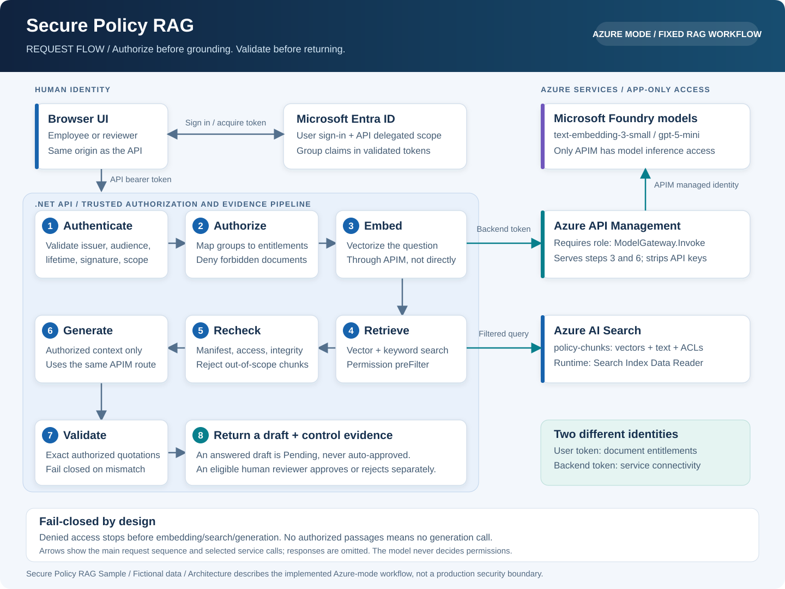
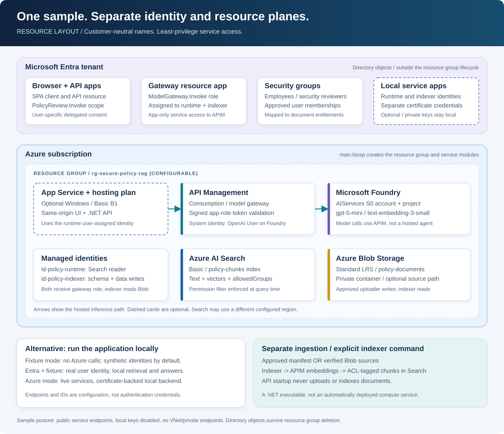

# Secure Policy RAG Sample

A customer-neutral ASP.NET Core sample that demonstrates **authorize before grounding**:

1. authenticate the caller;
2. determine the caller's document entitlements;
3. apply those entitlements inside retrieval;
4. validate every retrieved passage again before generation;
5. allow only exact quotations from authorized passages; and
6. keep human review separate from model output.

All included policies, identities, and scenarios are fictional. This is an educational sample, not a
production compliance system.

## What the sample contains

- ASP.NET Core API and same-origin browser UI.
- Local fixture mode that requires no Azure resources.
- Optional real Microsoft Entra authentication with local fixture retrieval.
- Azure mode using Azure AI Search and model calls routed through API Management.
- A separate, explicitly invoked indexer; normal API startup never uploads or indexes data.
- Infrastructure-as-code examples for Search, Microsoft Foundry, API Management, Storage,
  managed identities, app registrations, and security groups.
- Tests for explicit denial, permission-prefiltered retrieval, prompt-injection content,
  missing evidence, exact-quote validation, and reviewer access.

### Chat experience

The browser provides a chat-first interface with suggested questions, a bottom composer
(Enter to send; Shift+Enter for a newline), and expandable source cards containing the
authorized quotation, document ID, version, and chunk ID. Control evidence remains available
below the conversation, and each answered draft retains its explicit review actions.

This is a tab-local conversation log, not model conversation memory: each request sends only
the current question and document scope, and is independently authorized. Ask complete questions;
follow-ups such as "what about that?" do not inherit earlier context. Changing identity clears
the transcript, including when a synthetic demo scenario switches profiles. **New chat** clears
the local transcript but does not delete server-side drafts or change identity/document scope.
Refreshing the page also clears the transcript; no browser transcript storage is used.
Fixture-mode replies are scripted examples, not evidence of live model or Azure Search behavior.

### Week 4: evaluate, trace, and hand off

The [Week 4 runbook](docs/week4-evaluation.md) covers the 20-case evaluation runner,
baseline/candidate prompt experiment, local HTML/JSON/CSV reports, read-only browser comparison,
human scoring rubric, Entra-authenticated Application Insights traces, and handoff gates.
Telemetry is off by default in code; the clinic machine explicitly enables it through local API
User Secrets. The configured workbook and three Azure-mode-only alerts reuse existing monitoring
resources through [infra/monitoring.bicep](infra/monitoring.bicep). Cloud ingestion and all workbook/
alert queries were verified. Alerts are portal-only until an approved action group is supplied.
Fixture results are control evidence, not proof of live model quality.

## Architecture

### Overall request flow



[Open the full-size request-flow diagram](docs/architecture/request-flow.svg).
Read the numbered API steps left-to-right, then right-to-left on the second row.
The browser's delegated user token establishes document entitlements. A separate backend
application token authenticates service calls; it does not replace user authorization.

The API embeds the authorized request through APIM, retrieves with an ACL prefilter, rechecks
all passages, and uses the same APIM gateway for generation. No authorized context means no
generation call. Only exact quotations from authorized passages can become an answered draft.
Human approval is a separate, explicitly authorized operation, not a model action.

### Resource and identity layout



[Open the full-size resource-layout diagram](docs/architecture/resource-layout.svg).
This shows resources declared by the templates, not a claim that they have been deployed.
Entra applications, service principals, grants, and groups belong to the tenant, outside the
resource group's lifecycle. Optional App Service uses the runtime managed identity; a locally
running Azure-mode backend uses its dedicated certificate-backed identity instead.

| Component | Purpose and access boundary | Infrastructure |
|---|---|---|
| Browser + .NET API | Same-origin UI, bearer-token validation, document authorization, exact-quote validation, and review | Local process, or optional [App Service](infra/app-service.bicep) |
| Entra registrations + groups | Browser/API delegated permission, gateway application role, and approved user memberships | [User identity](infra/identity.bicep), [gateway identity](infra/gateway-identity.bicep), optional [local service identities](infra/backend-identity.bicep) |
| Azure AI Search | Hybrid/vector retrieval of text, vectors, and chunk ACLs; runtime reads, separate indexer writes | [Services](infra/services.bicep) |
| API Management | Validates `ModelGateway.Invoke` application role; routes embeddings and generation with its managed identity | [Services](infra/services.bicep), [gateway policy](infra/gateway-active-policy.xml) |
| Microsoft Foundry | Account/project and model deployments; only APIM receives inference permission | [Services](infra/services.bicep) |
| Blob Storage | Optional source workflow; approved operator uploads, indexer reads, container is not anonymous | [Storage](infra/storage.bicep) |
| Standalone indexer | Explicit ingestion from the approved local manifest or integrity-verified Blob files; embeds through APIM and writes ACL-tagged Search chunks | [Indexer executable](backend/PolicyRag.Indexer/Program.cs); no compute host is automatically deployed |
| Review store | In-memory sample draft/review state; not a provisioned database or durable production store | [Review store](backend/PolicyRag.Infrastructure/Storage/ReviewStore.cs) |

| Experience | User identity | Retrieval and answers | Backend credential |
|---|---|---|---|
| Local fixture | Synthetic employee/reviewer | Local fixtures | None |
| Entra + fixture | Real Entra user and groups | Local fixtures | No downstream Azure credential needed |
| Azure mode, local host | Real Entra user and groups | Search + APIM + Foundry | Dedicated service principal with certificate |
| Azure mode, App Service | Real Entra user and groups | Search + APIM + Foundry | Runtime user-assigned managed identity |

The diagrams intentionally do not show private networking, a hosted agent, a production ACL-sync
pipeline, or durable review storage: those are not implemented by this sample. The current service
endpoints are public with key authentication disabled; the Blob container is non-anonymous, not
network-private. See the production hardening checklist before adapting this architecture.

## Security test cases

| Case | Expected behavior |
|---|---|
| Authorized request | Retrieves only documents allowed for the current identity and returns exact quotations. |
| Denied document | Rejects an explicitly forbidden document before embedding, search, or generation. |
| Free-text restricted question | Permission-filtered retrieval excludes restricted chunks when no document ID is supplied. |
| Untrusted appendix | Treats retrieved instructions as data, not executable authority. |
| Missing evidence | Returns insufficient evidence rather than inventing an answer. |

## Who configures document access?

Document access is a data/application authorization policy, not only an infrastructure setting.
Three separate layers work together:

| Layer | Controls | Typical owner |
|---|---|---|
| Infrastructure RBAC | Which service identities can access Search, Storage, or models | Platform/security team |
| Identity | Which users belong to which Entra groups | Identity administrators |
| Document authorization | Which groups can read each document | Document owners/data-governance team |

For example, **Search Index Data Reader** allows the backend to query an index. It does not, by
itself, restrict results to documents that the signed-in user may read.

### How this sample implements it

- [backend/Data/policies.json](backend/Data/policies.json) is the sample's approved document
  catalog. Each document's `allowedGroups` defines its document-level access policy.
- `Rag:Azure:GroupMappings` maps real Entra group object IDs to sample entitlements such as
  `employees` and `security-reviewers`. Group membership comes from validated API-token claims,
  not browser input.
- Ingestion copies document permissions onto indexed chunks.
- The backend applies the caller's permission filter inside the Search query before grounding.
  It validates the returned passages against the approved catalog again before generation.
- The model does not grant access or choose which permissions to enforce.

### How to implement it in production

Prefer the source system's existing ACLs, such as SharePoint permissions, or a centrally managed
entitlement/policy service rather than maintaining a hand-edited JSON manifest. Document owners
approve access; trusted ingestion synchronizes those permissions onto every chunk, and the backend
enforces them for the authenticated caller. Use native document-level security where supported by
the selected service/API, or trusted server-side security filters where it is not.

Permission changes, deletions, and group-membership changes must propagate reliably. Define and
test revocation timing, refresh cached identity/entitlement information, and fail closed when
permissions cannot be established. Stale indexed ACLs or stale identity claims can expose data.
This sample demonstrates query-time enforcement; it does not implement a production ACL
synchronization or revocation pipeline.

**Infrastructure controls which services can connect. Document permissions control which content
each user can retrieve. Both are required, and neither is decided by the model.**

## Prerequisites

For local fixture mode:

- [.NET 10 SDK](https://dotnet.microsoft.com/download/dotnet/10.0)
- PowerShell 7 or Windows PowerShell

For Azure mode:

- An Azure subscription where you may deploy the selected model SKUs.
- Azure CLI and PowerShell 7 for the deployment script; Azure PowerShell is optional for the consent helper.
- Permissions to deploy resource groups, role assignments, Microsoft Graph application objects,
  service principals, and groups.
- A tenant administrator for delegated-consent approval when tenant policy requires it.
- Bicep with Microsoft Graph extension support.

Model availability, quota, supported versions, networking policy, and prices vary by subscription
and region. Review [infra/services.bicep](infra/services.bicep) before deploying.

## Get started locally

From the repository root:

```powershell
dotnet restore
dotnet build
dotnet test --configuration Release --no-restore
dotnet run --project .\backend\PolicyRag.Api --launch-profile Local
```

Open <http://localhost:5270/>. The page must display **FIXTURE MODE**.

Fixture mode uses:

- synthetic employee/reviewer identities;
- local fictional data from [backend/Data/policies.json](backend/Data/policies.json);
- local keyword retrieval; and
- scripted extractive answers.

It makes no Azure AI Search, embedding, or answer-model calls. This is the fastest way to evaluate
the authorization and evidence behavior.

## Configuration precedence

The application uses standard .NET configuration precedence:

1. [backend/PolicyRag.Api/appsettings.json](backend/PolicyRag.Api/appsettings.json) provides safe
   fixture defaults.
2. `appsettings.{Environment}.json` may provide non-sensitive environment defaults.
3. Development User Secrets override the JSON files.
4. Environment variables override JSON files and User Secrets; command-line configuration has highest priority.
5. The selected profile in
   [backend/PolicyRag.Api/Properties/launchSettings.json](backend/PolicyRag.Api/Properties/launchSettings.json)
   supplies the mode, local URL, and authentication switches. Local profiles explicitly force
   fixture mode and synthetic identity.

Nested .NET settings use double underscores in environment variables. For example,
`Rag:Azure:SearchEndpoint` becomes `Rag__Azure__SearchEndpoint`.

Do not commit tenant IDs, object IDs, resource endpoints, access tokens, client secrets, or
customer data. Use environment variables, a local untracked settings file, or your organization's
approved secret/configuration service.

For Visual Studio development, right-click `PolicyRag.Api` and select **Manage User Secrets**.
Store the same `Rag:Azure:*` and `BrowserSignIn:*` values shown below in that local secrets file.
The project defines a `UserSecretsId`, but no environment values are stored in the repository.

## Test real Entra identity with fixture retrieval

This mode validates real API bearer tokens and group claims while retaining local fixture data.
It is useful before Azure Search and model resources are ready.

Restore the pinned browser dependency before using either real-Entra profile or publishing:

```powershell
.\infra\Restore-BrowserAssets.ps1
```

This downloads MSAL Browser 4.30.0 and its license using [libman.json](libman.json), verifies reviewed
SHA256 hashes, and writes ignored vendor assets. Node/npm is not required. The source ZIP deliberately
does not bundle generated vendor files; ordinary `dotnet restore` does not restore them. If external
downloads are blocked, have your platform team supply the exact hash-verified assets through approved
tooling. Browser-enabled startup fails explicitly if the script has not been run.

First deploy or create:

- a single-tenant API registration exposing `PolicyReview.Invoke`;
- a localhost SPA registration with
  `http://localhost:5280/auth-callback.html` as a redirect URI;
- employee and reviewer security groups; and
- delegated consent for the test users.

Then configure the current PowerShell process:

```powershell
$tenantId = '<tenant-guid>'
$apiAudience = '<api-application-client-id>'
$browserClientId = '<spa-application-client-id>'
$apiScope = "api://$tenantId/<api-identifier>/PolicyReview.Invoke"
$employeeGroupId = '<employee-group-object-id>'
$reviewerGroupId = '<reviewer-group-object-id>'

$env:Rag__Azure__TenantId = $tenantId
$env:Rag__Azure__Audience = $apiAudience
$env:BrowserSignIn__ClientId = $browserClientId
$env:BrowserSignIn__Scope = $apiScope
$env:BrowserSignIn__RedirectUri = 'http://localhost:5280/auth-callback.html'
Set-Item -Path "Env:Rag__Azure__GroupMappings__${employeeGroupId}__0" -Value 'employees'
Set-Item -Path "Env:Rag__Azure__GroupMappings__${reviewerGroupId}__0" -Value 'security-reviewers'

dotnet run --project .\backend\PolicyRag.Api --launch-profile EntraFixture
```

Open <http://localhost:5280/>, select **Sign in with Microsoft**, and test with approved employee
and reviewer accounts. The mode banner must say **FIXTURE DATA / REAL ENTRA IDENTITY**.

Browser sign-in authenticates the human caller to the API. It does not authenticate the backend to
Search or API Management; those are separate credentials in Azure mode.

## Deploy your own Azure environment

Use [infra/Deploy-Sample.ps1](infra/Deploy-Sample.ps1). Nothing deploys automatically when the
application starts or when this repository is cloned.

### 1. Prepare approved configuration and certificates

```powershell
Copy-Item .\infra\environment.example.json .\infra\environment.local.json
```

Edit the local copy. Replace **every** placeholder and the example publisher email. Set your
tenant/subscription, region, resource group, and approved **user object IDs** for the owner and
Blob uploader. Populate `employeeMemberIds` and `reviewerMemberIds` with explicitly approved
Member users. Empty arrays create empty groups; ownership does not confer document access.
Use a dedicated resource group. Leave `appServiceName` empty for local hosting, or choose a
globally unique lowercase name for optional Windows App Service (Basic B1, billable).

For unattended local Azure mode, obtain two distinct development certificates through approved
tooling: one for the API runtime and one for the indexer. Keep private-key PEM/PFX files outside
the repository. Export only DER public `.cer` files for the script. It does not generate, export,
or store private keys. Certificate dates must be valid; plan rotation before expiry.
Omit either certificate parameter if that local identity is not needed.

For an approved **Windows development-only** self-signed certificate, the following is an example
for one identity. Use a user-private directory outside the repository and a strong export password.
Repeat with `indexer` to generate a different key; production credentials should follow your PKI policy.

```powershell
$credentialDirectory = Join-Path $env:LOCALAPPDATA 'SecurePolicyRagCredentials'
New-Item -ItemType Directory -Path $credentialDirectory -Force | Out-Null
$purpose = 'runtime' # Repeat with 'indexer'.
$password = Read-Host 'Private certificate export password' -AsSecureString
$certificate = New-SelfSignedCertificate -Subject "CN=PolicyRag-Local-$purpose" `
  -CertStoreLocation Cert:\CurrentUser\My -KeyAlgorithm RSA -KeyLength 2048 `
  -HashAlgorithm SHA256 -KeyExportPolicy Exportable -NotAfter (Get-Date).AddDays(90)
Export-Certificate -Cert $certificate `
  -FilePath (Join-Path $credentialDirectory "$purpose-public.cer") | Out-Null
Export-PfxCertificate -Cert $certificate -Password $password `
  -FilePath (Join-Path $credentialDirectory "$purpose-private.pfx") | Out-Null
```

Pass these public paths to the deployment command instead of the example `C:\private` paths.
At runtime use the matching private `.pfx` path and supply
`AZURE_CLIENT_CERTIFICATE_PASSWORD` through your approved local secret mechanism. Never paste the
password into source, shell history, screenshots, or the deployment JSON. The `New-SelfSignedCertificate`
cmdlet requires the Windows PKI module; on other platforms use your organization's approved PKI tools.

### 2. Validate and preview

```powershell
# Compilation/configuration only: no login, cloud reads, or deployment.
# First compilation may download pinned public Bicep modules/extensions.
.\infra\Deploy-Sample.ps1 -ConfigurationPath .\infra\environment.local.json -ValidateOnly

# Operator provisioning login, not an application runtime dependency.
$config = Get-Content .\infra\environment.local.json -Raw | ConvertFrom-Json
az login --tenant $config.tenantId
az account set --subscription $config.subscriptionId
.\infra\Deploy-Sample.ps1 -ConfigurationPath .\infra\environment.local.json -WhatIf
```

`-WhatIf` reads the selected CLI account and previews stages without writes. It is **not** an ARM
resource diff or a Microsoft Graph permission/quota validation. The Graph extension does not
support ARM what-if. Template compilation cannot prove region/model availability or runtime access.

The provisioning operator needs subscription deployment and role-assignment authority, plus
approved directory authority to manage applications, service principals, groups/membership, and
application-role assignments. Azure Contributor alone is insufficient. Coordinate with your tenant
administrator; do not grant directory administration to the application runtime.

### 3. Deploy explicitly

```powershell
.\infra\Deploy-Sample.ps1 -ConfigurationPath .\infra\environment.local.json `
  -BackendPublicCertificatePath 'C:\private\runtime-public.cer' `
  -IndexerPublicCertificatePath 'C:\private\indexer-public.cer'
```

Review the confirmation before proceeding. The script creates the resource group, gateway/API/SPA
registrations and groups, Search/Foundry/APIM/Storage, runtime/indexer managed identities, and
their explicit gateway application-role assignments. It optionally creates the certificate-backed
local identities and App Service. The runtime gets **Search Index Data Reader** only; the separate
indexer gets **Search Service Contributor** and **Search Index Data Contributor**. Only APIM's
managed identity receives model inference access.

Outputs are saved beside the configuration as `deployment.local.json` (ignored, nonsecret but
environment-specific). Keep them private. Failures stop the script; deployments are not transactional.
Inspect partial deployment results before rerunning with the same configuration. Names and existing
assignments are reused; a rerun is not a cleanup/revocation mechanism. Directory propagation and
RBAC propagation may require waiting before retrying. Do not retry permission/quota failures blindly.
Retain the same resource group, identity purpose, and configuration to avoid unintended duplicate environments.

### 4. Approve browser consent

Consent is deliberately **not** automated by deployment. Have the tenant administrator review
the `PolicyReview.Invoke` delegated permission for the explicitly approved users.
[infra/Set-BrowserConsent.ps1](infra/Set-BrowserConsent.ps1) supports per-user `Principal`
grants, not tenant-wide `AllPrincipals` grants. With approved Azure PowerShell available:

```powershell
$deployment = Get-Content .\infra\deployment.local.json -Raw | ConvertFrom-Json
Connect-AzAccount -Tenant $config.tenantId -Subscription $config.subscriptionId
.\infra\Set-BrowserConsent.ps1 -TenantId $config.tenantId `
  -BrowserServicePrincipalId $deployment.identity.browser.servicePrincipalId `
  -ApiServicePrincipalId $deployment.identity.api.servicePrincipalId `
  -PrincipalIds $deployment.identity.browser.consentPrincipalIds -WhatIf
# Review, then repeat without -WhatIf.
```

If organizational policy blocks Azure PowerShell, ask the tenant administrator to provision the
same reviewed user-specific Graph grants through approved tooling. Do not bypass execution policy.
Do not run the helper with an empty approved-user list.

### 5. Load your settings and run

```powershell
.\infra\Restore-BrowserAssets.ps1
$deployment = Get-Content .\infra\deployment.local.json -Raw | ConvertFrom-Json
# API: store nonsecret environment settings outside the repository.
$deployment.applicationSettings | ConvertTo-Json |
  dotnet user-secrets set --project .\backend\PolicyRag.Api

# Also set current-process settings: the separate indexer does not read API User Secrets.
foreach ($property in $deployment.applicationSettings.PSObject.Properties) {
  Set-Item -Path ("Env:" + $property.Name.Replace(':', '__')) -Value $property.Value
}
```

Follow the separate indexer/runtime certificate steps below. App settings containing IDs and endpoints
are configuration, not credentials. The backend still needs a certificate locally or managed identity
when hosted. The human still signs into the UI for document permissions.

The `.example.bicepparam` files and individual templates remain available for teams deploying stages
separately. Do not deploy unchanged placeholders. Neither the script nor these templates include
another customer's environment settings.

### Important deployment considerations

- [infra/services.bicep](infra/services.bicep) currently declares `gpt-5-mini` and
  `text-embedding-3-small`. Change model name/version/capacity before deployment if unavailable.
- The sample enables public Azure service endpoints but disables local key authentication. Apply
  private networking and organization policy before production use.
- API Management receives model-inference permission; the browser never receives a model key.
- Deleting the resource group does not delete Entra app registrations, service principals, groups,
  or delegated grants. Remove directory objects through an approved identity-governance process.

## Configure and run Azure mode

The recommended script loads these values in step 5 above. The following is a **manual alternative**;
do not replace generated settings with placeholders. Use outputs from your own deployments:

```powershell
$tenantId = '<tenant-guid>'
$apiAudience = '<policy-api-client-id>'
$browserClientId = '<browser-client-id>'
$apiScope = 'api://<tenant-guid>/<policy-api-identifier>/PolicyReview.Invoke'
$employeeGroupId = '<employee-group-object-id>'
$reviewerGroupId = '<reviewer-group-object-id>'

$env:Rag__Azure__TenantId = $tenantId
$env:Rag__Azure__Audience = $apiAudience
$env:Rag__Azure__SearchEndpoint = 'https://<search-name>.search.windows.net'
$env:Rag__Azure__SearchIndex = 'policy-chunks'
$env:Rag__Azure__ApimEndpoint = 'https://<apim-name>.azure-api.net/'
$env:Rag__Azure__ApimScope = 'api://<tenant-guid>/<gateway-identifier>/.default'
$env:Rag__Azure__EmbeddingModel = 'text-embedding-3-small'
$env:Rag__Azure__AnswerModel = 'gpt-5-mini'
$env:Rag__Azure__EmbeddingDimensions = '1536'
$env:Rag__Azure__GenerationProtocol = 'OpenAI'
$env:BrowserSignIn__ClientId = $browserClientId
$env:BrowserSignIn__Scope = $apiScope
$env:BrowserSignIn__RedirectUri = 'http://localhost:5280/auth-callback.html'
Set-Item -Path "Env:Rag__Azure__GroupMappings__${employeeGroupId}__0" -Value 'employees'
Set-Item -Path "Env:Rag__Azure__GroupMappings__${reviewerGroupId}__0" -Value 'security-reviewers'
```

Authenticate the backend separately. In Development, the application uses
`DefaultAzureCredential`. The gateway requires the **application role** `ModelGateway.Invoke`;
a browser token or a developer's delegated CLI token is not sufficient.

### Backend identity (no interactive login at runtime)

The browser and backend have separate identities. Keep the existing browser/API registrations for
user sign-in and document-group enforcement.

For local unattended use:

If you supplied public certificates to `Deploy-Sample.ps1`, the registrations and access assignments
already exist. Skip manual steps 1-5 and use the runtime client ID from
`$deployment.backend.clientId.value` in step 6.

1. Generate a development certificate using your organization's approved tooling. Retain the private
   key locally with restricted access; export only the DER public certificate for registration.
2. Deploy [infra/backend-identity.bicep](infra/backend-identity.bicep) using the approved tenant,
   owner object ID, base64 public certificate, and its actual validity dates. This creates a dedicated
   development application and service principal. It does not create or export private credentials.

```powershell
# backend-public.cer must be a DER public certificate, not a private-key export.
$publicCertificate = [System.Security.Cryptography.X509Certificates.X509Certificate2]::new(
  (Resolve-Path 'C:\private\backend-public.cer').Path)
$publicKey = [Convert]::ToBase64String($publicCertificate.RawData)
az deployment group create --resource-group $resourceGroup `
  --name policy-rag-backend-identity `
  --template-file .\infra\backend-identity.bicep `
  --parameters tenantId=$tenantId ownerPrincipalId='<approved-owner-object-id>' `
    certificatePublicKey=$publicKey `
    certificateStartDateTime=$publicCertificate.NotBefore.ToUniversalTime().ToString('o') `
    certificateEndDateTime=$publicCertificate.NotAfter.ToUniversalTime().ToString('o')
```

Keep the matching private-key certificate file outside the repository. The deployment outputs
provide the backend client ID and service-principal object ID; these are different identifiers.

3. Deploy the updated gateway identity template so its `ModelGateway.Invoke` application role exists.
4. Preview and assign only gateway invocation and Search read access:

```powershell
.\infra\Grant-BackendAccess.ps1 `
  -TenantId '<tenant-guid>' `
  -BackendServicePrincipalId '<backend-service-principal-object-id>' `
  -GatewayServicePrincipalId '<gateway-service-principal-object-id>' `
  -SearchResourceId '/subscriptions/<subscription>/resourceGroups/<group>/providers/Microsoft.Search/searchServices/<name>' `
  -WhatIf
```

Review the preview, then repeat without `-WhatIf`. This provisioning step requires an administrator
or appropriately privileged operator to authenticate once. The running backend does not need that
operator's login. Without `-Indexer`, the script does not grant Search write access. `-Indexer` explicitly grants
the two Search ingestion roles to a separate identity. Neither mode grants directory or direct model access.

5. Deploy the updated APIM policy through the services template. **This changes gateway authorization
   from delegated `scp` to application `roles`; old delegated-only callers will intentionally be rejected.**
6. Configure the local backend process with:

```powershell
$env:AZURE_TENANT_ID = '<tenant-guid>'
$env:AZURE_CLIENT_ID = '<backend-application-client-id>'
$env:AZURE_CLIENT_CERTIFICATE_PATH = 'C:\private\backend-certificate.pem'
# For an encrypted PFX, also supply AZURE_CLIENT_CERTIFICATE_PASSWORD through an approved secret mechanism.
dotnet run --project .\backend\PolicyRag.Api --launch-profile Azure
```

The certificate file must include its private key in a format supported by `EnvironmentCredential`.
Never commit it, put it in the web root, or include it in the customer ZIP. Launch Visual Studio from
the configured shell if using these process environment variables; an already-open Visual Studio
does not inherit later environment changes.

For an Azure-hosted API, attach the runtime managed identity, assign it the same gateway application
role and Search reader access using the script, and configure `Rag:Azure:ManagedIdentityClientId`
when user-assigned. Outside Development, the backend uses managed identity rather than developer
credentials. No certificate, client secret, or `az login` is required at runtime.

The separate indexer also needs an approved app-only gateway assignment for embeddings, in addition
to its Search ingestion roles. Do not give the runtime identity ingestion permissions.

For troubleshooting a separately approved developer login to Azure services, token acquisition can
be checked without displaying tokens:

```powershell
az login --tenant $tenantId
az account get-access-token --resource 'https://search.azure.com' --query expiresOn --output tsv
```

This CLI check tests the CLI identity, not the certificate or managed identity used by the app.
Verify the actual backend identity with a real authorized application request and inspect its
control evidence. A health check alone does not verify downstream authentication.

### Ingest the fictional sample documents

Normal API startup never changes Search. After loading generated settings into the shell (step 5),
select the **indexer**, not the runtime certificate. These commands assume you supplied
`-IndexerPublicCertificatePath` during provisioning:

```powershell
$env:DOTNET_ENVIRONMENT = 'Development'
$env:Rag__Mode = 'Azure'
$env:AZURE_TENANT_ID = $config.tenantId
$env:AZURE_CLIENT_ID = $deployment.localIndexer.clientId.value
$env:AZURE_CLIENT_CERTIFICATE_PATH = 'C:\private\indexer-private.pem'
# Avoid an inherited client secret selecting a different credential.
Remove-Item Env:AZURE_CLIENT_SECRET -ErrorAction SilentlyContinue
dotnet run --project .\backend\PolicyRag.Indexer -- --ingest
```

This creates/updates the configured index and uploads only the manifest-approved fictional chunks.
Confirm ingestion succeeds before starting queries. The local indexer has no Blob access by default.
For the optional Blob workflow, configure:

```powershell
$env:Rag__Azure__BlobEndpoint = 'https://<storage-account>.blob.core.windows.net'
$env:Rag__Azure__BlobContainer = 'policy-documents'

dotnet run --project .\backend\PolicyRag.Indexer -- --upload-sources
dotnet run --project .\backend\PolicyRag.Indexer -- --verify-sources
dotnet run --project .\backend\PolicyRag.Indexer -- --ingest-blob
```

Run `--upload-sources` under the approved uploader user's identity (the script grants that user
container-scoped Blob Data Contributor), not the reader-only runtime identity. An unattended local
Blob indexer additionally needs an administrator to grant its distinct service principal **Storage
Blob Data Reader** at the exact container scope. Do not copy the uploader's write role to the runtime.
The provisioned indexer managed identity already has container read access for Azure-hosted ingestion.
Do not run Blob commands until the selected identity's additional access has been approved.

Then switch back to the **runtime** certificate and start the app:

```powershell
$env:AZURE_CLIENT_ID = $deployment.backend.clientId.value
$env:AZURE_CLIENT_CERTIFICATE_PATH = 'C:\private\runtime-private.pem'
dotnet run --project .\backend\PolicyRag.Api --launch-profile Azure
```

Open <http://localhost:5280/>. The banner must say **AZURE MODE**. Sign in with Microsoft and run
the security test cases.

## Optional App Service hosting

Set `appServiceName` before deployment. The script registers both the localhost and hosted HTTPS
SPA callbacks, attaches the existing runtime user-assigned managed identity, and configures
Production/Azure mode, exact `AllowedHosts`, the HTTPS callback, and environment-specific settings.
No APIM subscription key, Search key, private certificate, or client secret is needed in App Service.
App Service identity grants service connectivity; Entra user/group claims still control documents.

The template uses Windows/IIS so same-origin checks retain the external HTTPS scheme without
trusting arbitrary forwarded headers. Custom domains or a different reverse proxy require an
explicit review of hostname, HTTPS forwarding, and redirect registration; do not simply enable
unrestricted forwarded-header trust.

Infrastructure deployment does **not** publish code. Complete consent and ingestion, then publish
a self-contained Windows x64 build (so the sample does not depend on a preinstalled .NET 10 runtime):

```powershell
$publish = Join-Path ([IO.Path]::GetTempPath()) ("policy-rag-publish-" + [Guid]::NewGuid())
$zip = "$publish.zip"
.\infra\Restore-BrowserAssets.ps1
dotnet publish .\backend\PolicyRag.Api -c Release -r win-x64 --self-contained true -o $publish
if ($LASTEXITCODE -ne 0) { throw 'Publish failed; do not deploy an incomplete package.' }
Compress-Archive -Path (Join-Path $publish '*') -DestinationPath $zip
az webapp deploy --subscription $config.subscriptionId --resource-group $config.resourceGroupName `
  --name $config.appServiceName --type zip --src-path $zip
if ($LASTEXITCODE -ne 0) { throw 'App Service deployment failed; inspect deployment logs.' }
Invoke-RestMethod "https://$($config.appServiceName).azurewebsites.net/health"
```

Open the hosted URL and run authorized employee/reviewer and denial scenarios. A successful health
check proves startup only, not Search/APIM authentication or authorization. Allow time for role
propagation; inspect failed sign-ins, APIM responses, and correlation IDs rather than falling back
to fixture data or adding broad roles. Remove your temporary publish directory and ZIP when finished.

## Cleanup and public-repository handoff

The deployment uses billable Search, models, Storage, APIM, and optionally App Service. Review prices
before approving deployment. When finished, review the target and delete **only your dedicated**
resource group:

```powershell
az group delete --subscription $config.subscriptionId --name $config.resourceGroupName
```

This does not delete Entra applications, service principals, groups, consent grants, or credentials.
Use saved deployment outputs and deployment history to inventory those objects and have an approved
directory administrator remove them and revoke certificate access. A rerun does not remove old members,
grants, or obsolete environments. Remove private certificates and local settings using approved
credential-retention procedures.

Before publishing, review all staged files and repository history, not only `.gitignore`.
The [.gitignore](.gitignore) excludes build/IDE output, local environment settings, certificate
exports, restored vendor assets, publish folders/packages, and generated Bicep JSON. Example
configuration and Bicep source remain included. Ignore rules do not remove files already tracked.
Never publish local configuration/outputs, certificates, User Secrets, `.vs`, build/publish output,
tokens, customer documents, or another environment's IDs/endpoints. The ignored local files are
not a secret store. Choose an owner-approved open-source license before public distribution; this
sample does not select a license on your behalf.

## Verify expected evidence

The response includes control evidence:

- `authorization`
- `embeddingCalls`
- `searchCalls`
- `generationCalls`
- `validation`
- `sourceIds`
- `correlationId`

Expected checks:

- Explicit denial: HTTP 403 with zero embedding, search, and generation calls.
- Employee free-text restricted question: no restricted citation.
- Reviewer restricted question: restricted citation may be returned when relevant.
- No authorized context: no generation call and an insufficient-evidence answer.
- Any unauthorized or non-exact citation: request fails closed.

Health and public runtime configuration are available at:

```powershell
Invoke-RestMethod http://localhost:5280/health
Invoke-RestMethod http://localhost:5280/api/config
```

`/api/config` intentionally publishes only browser-safe configuration. It must never contain
credentials or tokens.

## Build and test

```powershell
dotnet build
dotnet test --configuration Release
dotnet format --verify-no-changes --no-restore
pwsh -NoProfile -File .\tests\Test-Deployment.ps1
```

The GitHub Actions workflow runs restore, Release tests, formatting verification, and the mocked
PowerShell deployment tests. The mock tests validate compilation-only/preview boundaries and
runtime-versus-indexer grants without contacting Azure. Run `-ValidateOnly` with your own valid
configuration to compile the actual Bicep modules; no live deployment is implied by these tests.

## Repository layout

```text
backend/
  Data/                       Fictional manifest and approved source documents
  PolicyRag.Api/              ASP.NET Core API and browser UI
  PolicyRag.Application/      Domain model and secure orchestration
  PolicyRag.Infrastructure/   Fixture, Search, APIM/model, Blob, and storage adapters
  PolicyRag.Indexer/          Explicit ingestion/upload executable
infra/                        Bicep, APIM policies, and consent helper
tests/                        Unit and HTTP integration tests
```

## Production hardening checklist

Before adapting this sample for production:

- replace fictional authorization mappings with an approved entitlement source;
- use private networking and managed identities;
- move configuration to an approved configuration/secret service;
- add durable, encrypted review storage and retention controls;
- add audit telemetry without logging policy text, tokens, or prompts;
- threat-model ingestion and document lifecycle separately from query-time RAG;
- validate model/version availability and safety policy;
- implement operational monitoring, quotas, disaster recovery, and incident response; and
- complete organizational privacy, security, legal, and compliance reviews.

The model produces a draft. It does not approve access, prove that a control was performed, or make
a compliance determination.
